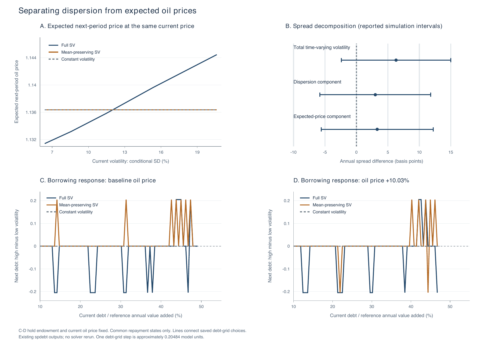

# Response to R2 Major 1 and R1 Major 2

This response uses existing spdebt outputs. The solver, calibration and convergence criteria are unchanged.

## Mean-preserving specification

With z = log p and h the log innovation variance, the adjusted law is:
```text
z_next = (1-rho_p)*z_bar + rho_p*z - 0.5*(exp(h_next)-v0) + exp(h_next/2)*u_next
v0 = E[exp(h)]
```

For the continuous law, E[p_next | z,h_next] = exp((1-rho_p)*z_bar + rho_p*z + v0/2), independent of next-period volatility. Figure 1A holds the current physical price fixed and integrates over future volatility. The finite grid remains only approximately mean-preserving near boundaries, and the one-step correction does not equalize every multi-period expectation.



## Table 1. Simulated economies

| Economy | Spread (bp) | Debt/GDP (%) | Default entries / 100 quarters | Entries / 100 eligible quarters |
|---|---:|---:|---:|---:|
| Full SV | 409.0 | 34.05 | 0.7768 | 0.8558 |
| Mean-preserving SV | 405.7 | 33.89 | 0.7657 | 0.8425 |
| Constant volatility | 402.7 | 33.46 | 0.7724 | 0.8501 |

Spreads and debt/GDP follow the existing pre-default-window convention. Frequencies use all 750,000 quarters in each economy. Eligible quarters follow a quarter outside exclusion.

## Table 2. Spread decomposition

| Comparison | Difference (bp) | Reported 95% simulation interval |
|---|---:|---|
| Full - constant volatility | +6.3 | [-2.4, 15.0] |
| Mean-preserving - constant volatility: dispersion | +3.0 | [-5.8, 11.8] |
| Full - mean-preserving: expected price | +3.3 | [-5.6, 12.2] |

The two components sum to the total. All three intervals include zero. These are existing Monte Carlo summaries, not structural-parameter confidence intervals. The results do not attribute the whole average volatility effect to pure dispersion.

## Table 3. High minus low volatility at identical current states

Current debt is 11.67582, or 33.72% of reference annual value added. Log endowment is zero. Oil prices are 1.12750 and 1.24061 (+10.03%). All representative states repay today.

| Economy | Current price | Change in next debt | Spread change (bp) | Next default probability change (pp) |
|---|---|---:|---:|---:|
| Full SV | Baseline | 0.00000 | 49.11 | 0.02384 |
| Full SV | Oil +10.03% | 0.00000 | 69.10 | 0.09776 |
| Mean-preserving SV | Baseline | 0.00000 | 36.98 | 0.01555 |
| Mean-preserving SV | Oil +10.03% | 0.00000 | 50.71 | 0.06808 |
| Constant volatility | Baseline | 0.00000 | 0.00 | 0.00000 |
| Constant volatility | Oil +10.03% | 0.00000 | 0.00 | 0.00000 |

Next-period default probabilities use the saved default policy at today's chosen repayment debt, integrating over endowment, future volatility and the future price. They differ from today's default decision and long-run entry frequencies.

## Table 4. Borrowing changes across debt nodes

| Economy | Price case | More debt | Unchanged | Less debt | States |
|---|---|---:|---:|---:|---:|
| Full SV | Baseline | 4 | 53 | 10 | 67 |
| Full SV | Oil +10.03% | 3 | 50 | 10 | 63 |
| Mean-preserving SV | Baseline | 7 | 59 | 0 | 66 |
| Mean-preserving SV | Oil +10.03% | 5 | 56 | 2 | 63 |

Counts cover debt nodes between 10% and 55% of reference annual value added, at log endowment zero, with repayment at both volatility extremes. They are equal-weight grid counts, not ergodic probabilities. The comparison uses different repayment sets where default policies differ. One debt-grid step is approximately 0.20484 model units.

## Response and revised interpretation

We thank both referees for pointing out that the original specification changes expected prices and dispersion simultaneously. We implement the proposed one-step mean-preserving adjustment and report the dispersion and expected-price comparisons separately. The average-spread components are small relative to their reported simulation intervals. Conditional dispersion effects on spreads and next-period default risk can nevertheless remain positive.

At the representative state, higher volatility leaves borrowing unchanged, with and without the expected-price correction. Across other debt states, some increases survive in the mean-preserving specification, but the response is not general. The evidence therefore supports neither a universal precautionary-borrowing claim nor its replacement with a universal precautionary-saving claim. Average debt/GDP differences do not establish the conditional mechanism.

The original general borrowing claim should be qualified accordingly. The newer draft assertion that isolated dispersion induces precautionary saving should be removed: it is not supported by these adopted-calibration policy comparisons.

Full response, definitions and figure notes: Response_R2M1_R1M2.pdf. Source set: model/src_spdebt at 0898dc7. Run and input provenance: analysis.json.
